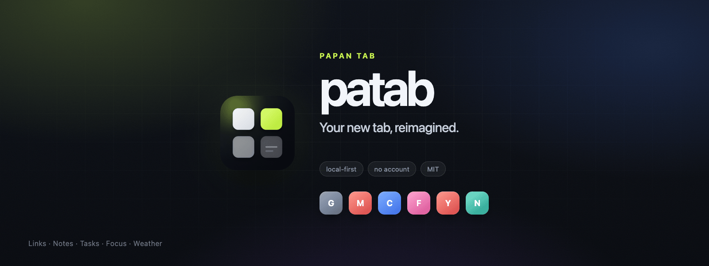
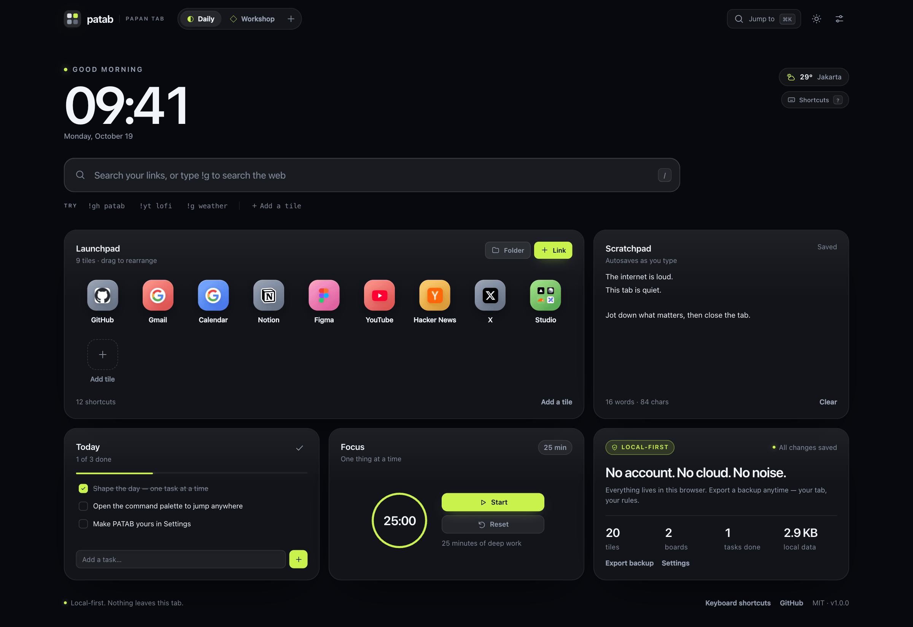
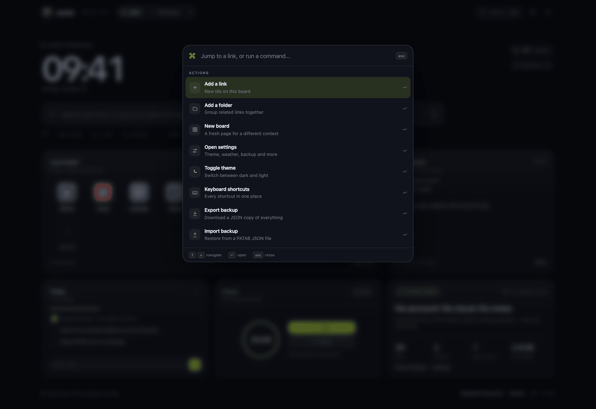
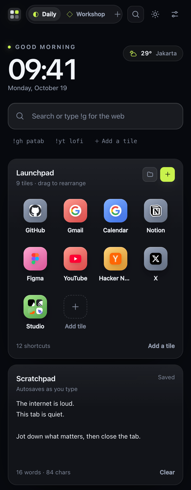
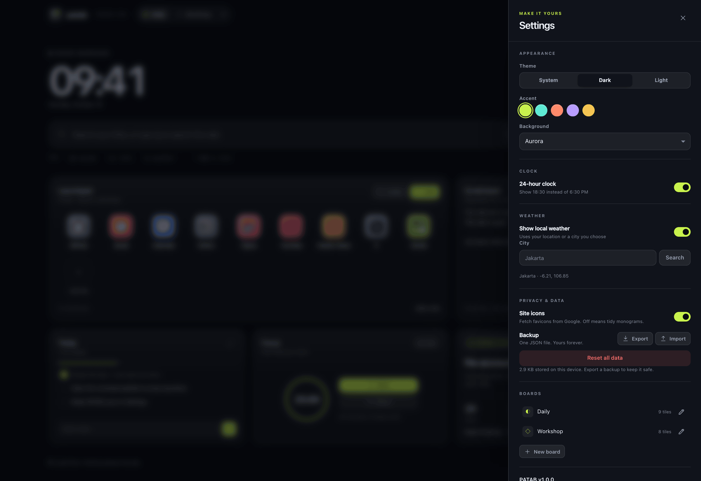
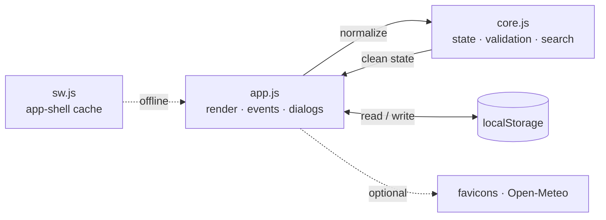

<div align="center">
  
</div>

<h1 align="center">PATAB</h1>

<p align="center">
  <strong>Your new tab, reimagined.</strong><br />
  A calm, local-first dashboard for the loud internet. Links, notes, tasks and focus —<br />
  in one quiet place that belongs entirely to you.
</p>

<p align="center">
  <a href="https://ilyasaalmadani.github.io/patab/"></a>
  
  
  
  
  <a href="https://github.com/ilyasaalmadani/patab/actions/workflows/ci.yml"></a>
</p>

<p align="center">
  <a href="#quick-start">Quick start</a> ·
  <a href="#features">Features</a> ·
  <a href="#keyboard-shortcuts">Shortcuts</a> ·
  <a href="#privacy">Privacy</a> ·
  <a href="#architecture">Architecture</a> ·
  <a href="#bahasa-indonesia">Bahasa Indonesia</a>
</p>

<p align="center">
  <picture>
    <source media="(prefers-color-scheme: dark)" srcset="docs/screenshots/dashboard-dark.png" />
    <source media="(prefers-color-scheme: light)" srcset="docs/screenshots/dashboard-light.png" />
    
  </picture>
</p>

---

## Why PATAB

Most new tabs are either blank or noisy. PATAB is the third option: a quiet, beautiful
page that still does real work.

No account. No onboarding maze. No telemetry. Open the tab, see your day, find anything
in two keystrokes, write something down, and get back to what matters. Everything is
stored in your browser and can leave only when you export it.

PATAB is built with hand-written HTML, CSS and JavaScript. There is no framework, no
build step and no runtime dependency — just a small, auditable app you can host anywhere.

## Features

- **A dashboard that fits on one screen** — clock, search, launchpad, scratchpad, tasks,
  focus timer and weather in a responsive bento layout.
- **Command palette** — press `⌘K` / `Ctrl K` to jump to any link or run an action.
- **Search that understands context** — fuzzy search across every board and folder,
  plus web bangs such as `!g`, `!gh`, `!yt`, `!w`, `!npm` and `!maps`.
- **Folders and boards** — group related links, and keep separate boards for separate
  contexts (Daily, Workshop, Research, anything).
- **Drag and drop** — reorder tiles with a mouse, or focus a tile and use
  `Alt + ←/→`. The layout is remembered.
- **A focus timer** — 25, 50 or 15 minute sessions with a live progress ring and a
  document title that counts down.
- **Autosaving scratchpad** — a quiet place for ideas, snippets and half-thoughts.
- **Tasks with progress** — add, complete and clear tasks without leaving the tab.
- **Optional weather** — Open-Meteo via your location or a city you choose.
- **Make it yours** — dark, light or system theme; five accent colors; aurora, grid or
  plain background; 12/24-hour clock.
- **Local-first data** — one-click JSON export and import. No sign-in, no sync server.
- **Installable PWA** — a service worker caches the app shell for offline use.
- **Privacy by design** — strict CSP, URL validation, `textContent` rendering and a
  tiny, readable codebase.
- **Accessible** — keyboard navigation, visible focus rings, ARIA labels, native
  dialogs and reduced-motion support.
- **Zero runtime dependencies** — no framework, no bundler, no `node_modules` needed
  to run the app.

<p align="center">
  
  
</p>

<details>
  <summary><strong>See the settings drawer</strong></summary>
  <br />
  
</details>

## Quick start

Requirements: a modern browser and, for the local server, Node.js 20 or newer.

```bash
git clone https://github.com/ilyasaalmadani/patab.git
cd patab
npm run dev
```

Open <http://localhost:4173>. There is nothing to install — `npm run dev` starts a
zero-dependency static server.

Prefer another server? Any static file server works:

```bash
python3 -m http.server 4173
# or
npx serve .
```

### Use it as your new tab

PATAB is a normal web page, so you can point your browser's homepage or startup page at
the demo URL. For a true new-tab replacement, use a redirect extension such as
"New Tab Redirect" and set it to `https://ilyasaalmadani.github.io/patab/`. On Chrome,
Edge and other Chromium browsers you can also install PATAB as a PWA from the address
bar. A dedicated browser-extension wrapper is on the roadmap.

### Tests

```bash
npm test       # 9 unit tests for state normalization, search, URLs and helpers
npm run check  # verifies local asset references, manifest icons, SW shell and LICENSE
```

An optional Playwright smoke test exercises the full UI (add/edit link, folders, tasks,
notes, theme, search, palette, reordering and persistence). It needs Google Chrome:

```bash
npm install
npm run test:e2e
```

### Lighthouse

Measured on 2026-10-19 with Lighthouse 12.8.2, mobile emulation, headless Chrome and a
local static server:

| Performance | Accessibility | Best practices | SEO |
| :---: | :---: | :---: | :---: |
| **98** | **100** | **100** | **100** |

Scores vary with hardware, network throttling and browser extensions. The app ships
with no runtime dependencies, a reserved layout to avoid shift, a strict CSP and
accessible names for every control.

## Keyboard shortcuts

| Action | Shortcut |
| --- | --- |
| Open command palette | `⌘K` / `Ctrl K` |
| Focus search | `/` |
| Add a link | `N` |
| Show shortcut help | `?` |
| Close a dialog or search | `Esc` |
| Reorder a focused tile | `Alt` + `←` / `→` |
| Open the focused tile | `Enter` |

## Privacy

PATAB stores everything in `localStorage` under the key `patab:state:v1`. There is no
backend, no account and no analytics.

Two features make **optional** network requests:

| Feature | Request | Default |
| --- | --- | --- |
| Site icons | `google.com/s2/favicons` for the domains you save | On; can be disabled in Settings |
| Weather | `api.open-meteo.com` and `geocoding-api.open-meteo.com` | Off until you enable it |

Turn off **Site icons** in Settings for a fully offline, monogram-only experience.
Weather is opt-in and can use a city you type instead of your location. The app shell
itself is served from your own host (GitHub Pages by default) and cached by the service
worker for offline use.

Read [PRIVACY.md](PRIVACY.md) for the full data map and [SECURITY.md](SECURITY.md) for
reporting a vulnerability.

## Architecture



```text
index.html              app shell and accessible markup
assets/theme.js         tiny pre-paint theme boot (no flash)
assets/core.js          pure state model, validation, fuzzy search, bangs
assets/app.js           UI shell, rendering, dialogs, drag and drop, PWA glue
assets/app.css          hand-written design system and responsive layout
assets/icon.svg         app mark; PNG icons rendered from it
sw.js                   offline app-shell cache
scripts/dev.mjs         zero-dependency static server
scripts/check.mjs       CI integrity check
scripts/screenshots.mjs real-browser screenshots and social images
scripts/e2e.mjs         optional Playwright smoke test
tests/core.test.mjs     unit tests for the state layer
```

The state layer is deliberately DOM-free so it can be tested with `node --test`.
Imported JSON, `localStorage` payloads and seed data all pass through the same
`normalizeState()` pipeline. Invalid URLs are dropped, `javascript:` and `data:` URLs
are rejected, strings are clamped, and IDs are de-duplicated. Rendering uses
`textContent` rather than injecting user content as HTML.

### Security posture

- Strict Content Security Policy: no inline scripts, no `eval`, no third-party scripts.
- Only `http:` and `https:` URLs can be saved as tiles.
- External requests are limited to the two optional features above.
- The app is fully static; there is no server-side attack surface.
- Dependencies: zero at runtime. `playwright-core` is a development-only dependency for
  screenshots and the optional smoke test.

## Deploy your own

The included GitHub Actions workflow deploys the static app to GitHub Pages on every
push to `main`. To use it:

1. Fork or clone the repository.
2. In **Settings → Pages**, set **Source** to **GitHub Actions**.
3. Push to `main`. The workflow publishes the app.

Cloudflare Pages, Netlify, Vercel and any static host work too. Use no build command
and serve the repository root. All asset paths are relative, so the app works from a
subpath such as `/patab/`.

## Roadmap

- [x] v1.0 — local-first dashboard, boards, folders, search, palette, focus, weather,
      themes, PWA, export/import
- [ ] Browser-extension wrapper for a one-click new-tab override
- [ ] Import browser bookmarks from an HTML export
- [ ] Optional end-to-end encrypted sync (bring your own storage)
- [ ] More widgets: calendar, RSS, quick capture
- [ ] Community translations

Have an idea that fits the "calm, local-first" philosophy? Open an issue.

## Contributing

Contributions are welcome — especially accessibility fixes, small performance wins,
translations and thoughtful visual polish. Please read [CONTRIBUTING.md](CONTRIBUTING.md)
and [CODE_OF_CONDUCT.md](CODE_OF_CONDUCT.md) first.

The guiding constraint is simple: **keep it small, readable and local-first**. No
framework, no build step, no tracking, and no feature that requires an account.

## License

[MIT](LICENSE) © 2026 Ilyas Akbar Almadani.

If PATAB makes your browser a little calmer, a star helps other people find it.

---

## Bahasa Indonesia

**PATAB (papan tab)** adalah dashboard local-first untuk tab baru: jam, pencarian,
shortcut, catatan, tugas, timer fokus, dan cuaca dalam satu halaman yang tenang.

- Semua data tersimpan di browser (`localStorage`). Tidak ada akun, server, atau analytics.
- Ekspor dan impor backup dalam satu file JSON.
- Pencarian cepat lintas board dan folder, plus bang seperti `!g`, `!gh`, dan `!yt`.
- Bisa dipasang sebagai PWA dan tetap bekerja offline.
- Tema gelap/terang, lima warna aksen, dan layout responsif.
- MIT — bebas dipakai, dimodifikasi, dan di-host sendiri.

Jalankan secara lokal:

```bash
git clone https://github.com/ilyasaalmadani/patab.git
cd patab
npm run dev
```

Buka <http://localhost:4173>. Dokumentasi lengkap dalam bahasa Indonesia ada di
[README.id.md](README.id.md).
